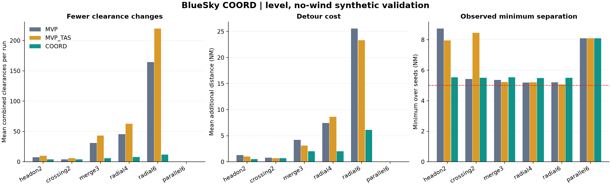

# BlueSky COORD — 空中交通管制定向优化第一版

**v0.1.0 · 由 [91longli666-rgb](https://github.com/91longli666-rgb) 维护的非官方研究优化分支。**

本项目基于 TU Delft 的 [BlueSky Open Air Traffic Simulator](https://github.com/TUDelft-CNS-ATM/bluesky)，新增 **COORD 多航空器协同冲突解脱插件**，研究如何在满足设定间隔约束的同时减少重复管制指令和绕飞。

BlueSky 的原始仿真平台与基础算法由上游作者及贡献者开发；本仓库的新增贡献为 COORD 插件、相关测试、对照实验和优化文档。本仓库不是上游官方发布版本。

## 原项目与署名

- **上游项目：** [TUDelft-CNS-ATM/bluesky](https://github.com/TUDelft-CNS-ATM/bluesky)
- **上游主要作者：** Jacco M. Hoekstra、Joost Ellerbroek，以及 BlueSky 的其他贡献者。
- **上游版权声明：** `Copyright (c) 2025 TU Delft`。
- **许可证：** 完整保留上游 [MIT LICENSE](LICENSE)；新增内容也按 MIT 发布，见 [LICENSE-COORD](LICENSE-COORD)。已有第三方文件的版权与许可声明保留。
- **来源：** 上游提交 [`46a2a8a`](https://github.com/TUDelft-CNS-ATM/bluesky/commit/46a2a8a5fa4e0bdd6f6991fefc70dc3512f8fc53)。详见 [NOTICE](NOTICE.md)、[原版 README](README-UPSTREAM.md)、[来源记录](research/coord/UPSTREAM.json)。

学术使用时请引用原项目论文：J. M. Hoekstra and J. Ellerbroek, “BlueSky ATC Simulator Project: an Open Data and Open Source Approach,” 7th International Conference for Research in Air Transportation (ICRAT), 2016。[论文信息](https://research.tudelft.nl/en/publications/bluesky-atc-simulator-project-an-open-data-and-open-source-approa/)

## 第一版优化

1. **多机联合解脱：** 联合选择受威胁飞机的航向与速度，同时校验背景飞机对。
2. **指令保持与恢复：** 保持已校验指令，恢复航路前重新检查；出现风险时允许立即重规划。
3. **响应过程预测：** 考虑转弯和加减速，检查预测线段内最近距离及恒定目标速度的终端条件。
4. **明确回退：** 无可行候选、超时、超限或条件不受支持时回退原版 MVP；失败后间隔 5 秒重试，期间 MVP 继续更新。
5. **可核查实验：** 提供原版 MVP、仅修正速度裁剪单位的 MVP_TAS 和 COORD 对照，以及轨迹、指标和测试。

## 验证结果

以下为 **16 组定高、无风、A320 合成场景**的累计结果，每组每种算法运行 600 秒，不是实际航班数据。

| 指标 | 原版 MVP | COORD |
|---|---:|---:|
| 组合管制指令次数 | 758 | **102** |
| 间隔违规事件 | 0 | 0 |
| 额外航程合计（NM，固定时长代理指标） | 117.883 | 34.011 |
| 回退更新次数 | — | 25 |

此验证集中指令次数减少 **86.5%**；新增 **28 项自动测试通过**。计数阈值、替代对照与失败记录见[完整实验报告](research/coord/results/优化实验报告.md)，不能将全部收益单独归因于某个算法机制。



**适用边界：** 局部空域、定高、无风、OpenAP 固定翼，单次最多联合优化 12 架受威胁飞机。16 机超限回退压力测试中，一组出现 3 次间隔违规，该结果完整保留。当前版本为研究原型。

## 运行

建议 Python 3.12。在仓库根目录执行：

```powershell
python -m venv .venv
.\.venv\Scripts\python.exe -m pip install -r requirements-coord.txt
.\run-coord.ps1 -Action test
.\run-coord.ps1 -Action demo
```

在已安装依赖的 BlueSky 界面中输入 `PLUGINS LOAD COORD`、`CDMETHOD STATEBASED`、`RESO COORD`；通过 `COORDSTATUS` 查看状态，`RESO MVP` 切回原方法。

- [完整运行和参数说明](README-COORD.md)
- [插件](bluesky/plugins/coord.py)与[独立规划器](bluesky/plugins/coord_core.py)
- [测试](tests/coord)、[实验与数据](research/coord)、[演示场景](scenario/COORD)
- [第一版改动](CHANGELOG.md)、[上游说明](README-UPSTREAM.md)、[署名与许可](NOTICE.md)
